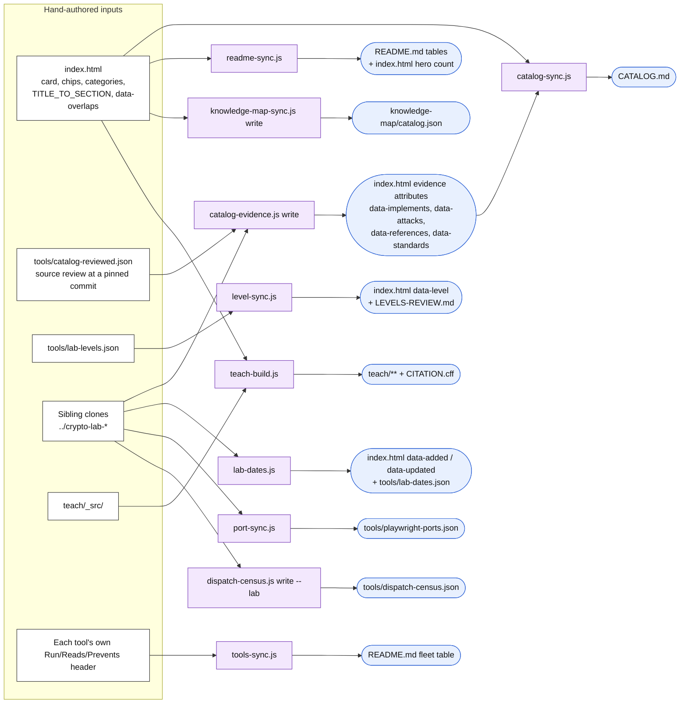

# Adding a lab to the catalog

How a new demo gets from a written brief to a card on the live catalog, across
all three repositories it touches. Everything below is derived from the code in
this repository at the commit you are reading it at — each row names the tool
that actually writes the file and the workflow that actually checks it.

## The lifecycle

A lab starts as a written brief and is built in its **own repository and its own
session**, against `audits/_MASTER-TEMPLATE.md`, until it publishes a live Pages
site from its `main`. That session ends with a `chat.md` 10/10 review, where the
**lab agent decides which findings to adopt** — the review advises, it does not
command. Only once the site serves the built bytes does a **separate hub session**
register it here: a hand-authored card in `index.html` plus hand-authored pins,
then the generators that derive every other view from them. The same session adds
the lab's record to `../crypto-counsel/corpus.json`, which is a different
repository with its own commit and push.

So registration is the third act, not the first, and it is deliberately not the
job of whoever built the lab.

## Brief to live

```mermaid
flowchart TD
  brief["Written brief"] --> build["Build in crypto-lab-&lt;slug&gt;<br/>own repo, own session"]

  subgraph LAB["Lab repo: crypto-lab-&lt;slug&gt;"]
    build --> review["chat.md 10/10 review<br/>lab agent decides what to adopt"]
    review --> labgate{{"Browser gate<br/>build + axe + e2e"}}
    labgate --> pages(["GitHub Pages site"])
  end

  pages --> deploycheck{{"deploy-sync check<br/>served bytes match main"}}
  deploycheck --> clone["Clone beside the hub<br/>full clone, never --depth 1"]

  subgraph HUB["Hub: crypto-lab"]
    clone --> card["index.html card<br/>+ TITLE_TO_SECTION"]
    card --> pins["Hand pins:<br/>catalog-reviewed.json<br/>lab-levels.json"]
    pins --> stamp(["Stampers write onto index.html:<br/>catalog-evidence, lab-dates, level-sync"])
    stamp --> registries(["Registries:<br/>port-sync, dispatch-census"])
    registries --> views(["Derived views:<br/>CATALOG.md, README.md,<br/>knowledge-map, teach/, CITATION.cff"])
    views --> handcounts["Hand-authored counts:<br/>concept-coverage.md, llms.txt"]
    handcounts --> hubgate{{"readme-sync.yml + teach.yml<br/>every PR and push"}}
  end

  subgraph COUNSEL["crypto-counsel"]
    corpus["corpus.json record<br/>+ README counts"]
    corpus --> corpusgate{{"corpus-sync check<br/>daily in fleet.yml"}}
  end

  hubgate --> corpus
  corpusgate --> live(["Card live on the catalog"])

  classDef hand fill:#fff,stroke:#333,stroke-width:1px,color:#111
  classDef gen fill:#e8f0fe,stroke:#3367d6,stroke-width:1px,color:#111
  classDef gate fill:#fdf0e3,stroke:#b8742a,stroke-width:1px,color:#111
  class brief,build,review,clone,card,pins,handcounts,corpus hand
  class pages,stamp,registries,views,live gen
  class labgate,deploycheck,hubgate,corpusgate gate
```



**Legend.** Square corners are **hand-authored** — a person types them, and no
tool will restore them. Rounded boxes are **generated** — a tool writes them, and
hand-editing them is overwritten on the next run. Hexagons are **CI gates**.

## Where each file comes from



Three files in the chain are hand-authored and have **no generator at all**:
`concept-coverage.md`, `llms.txt`, and `../crypto-counsel/corpus.json` with its
README counts.

## Registering a new lab

Run these in order. The order is not cosmetic: the stampers in step 5 write onto
`index.html`, and every derived view in step 7 reads `index.html`, so running
step 7 first publishes a card without its evidence, dates or level.

**1. Get current, before generating anything.**

```sh
git -C . pull --rebase --autostash
git -C ../crypto-counsel pull --rebase --autostash
git status --porcelain
```

Generators derive from whatever is on disk, so a stale `main` makes them write a
view of a catalog that no longer exists. If the tree is dirty, see
*Git hygiene* below before going on.

**2. Work in your own worktree, beside the clones.**

```sh
git worktree add ../crypto-lab-lane-<name> -b <branch>
```

Not somewhere tidier: every fleet checker resolves the fleet root as this repo's
parent, so a worktree outside it sees **zero** labs and several checkers then
report success over nothing.

**3. Clone the lab beside the others — a full clone.**

```sh
git clone https://github.com/systemslibrarian/crypto-lab-<slug> ../crypto-lab-<slug>
```

`--depth 1` is refused by `lab-dates`' writer and makes `git log` answer
confidently and wrongly.

**4. Hand-author the card and the pins.**

- `index.html`: the card block inside `<div class="project-grid">`, and the exact
  title in `TITLE_TO_SECTION`. Add to `FOUNDATIONS_TITLES` / `REAL_WORLD_TITLES`
  / `LEARNING_PATHS` only if it belongs there.
- `tools/catalog-reviewed.json`: the source review, pinned to the commit you
  actually read.
- `tools/lab-levels.json`: the level, with your own `title` and `why` — not the
  sample's.

**5. Run the stampers, which write onto `index.html`.**

```sh
node tools/catalog-evidence.js write
node tools/lab-dates.js
node tools/level-sync.js
```

**6. Pin the registries.**

```sh
node tools/port-sync.js
node tools/dispatch-census.js write --lab crypto-lab-<slug>
git diff --stat -- tools/playwright-ports.json tools/dispatch-census.json
```

Expect exactly one added row in each. A **removed** row is a lab that stopped
being seen, and is a finding rather than noise.

**7. Regenerate the derived views.**

```sh
node tools/catalog-sync.js
node tools/readme-sync.js
node tools/knowledge-map-sync.js write
node tools/teach-build.js
```

**8. Hand-author what no generator owns.** Recompute all three counts **after**
the pull in step 1 — never carry a figure over from before it:

- `concept-coverage.md`: add the exact card title to its concept's citation line,
  **append** a new `*Version N — …*` paragraph (never edit an existing one), and
  update `Catalogued total: N`.
- `llms.txt`: it carries the total, the hero count and the concept count in one
  sentence. Nothing generates or checks it.

**9. Check.** None of these writes a file:

```sh
node tools/readme-sync.js check
node tools/catalog-sync.js check
node tools/concept-sync.js check
node tools/llms-sync.js check
node tools/knowledge-map-sync.js check
node tools/teach-build.js check
node tools/level-sync.js check
node tools/lab-dates.js check
node tools/port-sync.js check
node tools/dispatch-sync.js check
node tools/theme-sync.js check
node tools/gate-sync.js check
node tools/deploy-sync.js check
```

**10. Add the corpus record, in the other repository.**

```sh
node tools/corpus-sync.js gen <slug> "<Demo Name>"
# fill the TODO prose, append the object to ../crypto-counsel/corpus.json
# (minified, single-line, no trailing newline), bump that README's three counts
node tools/corpus-sync.js check
```

A clean run prints `Missing from corpus (0): []` and `Stale in corpus (0): []`.

**11. Stage by explicit path. Never `git add -A`.**

```sh
git add index.html README.md CATALOG.md concept-coverage.md llms.txt \
        LEVELS-REVIEW.md CITATION.cff knowledge-map/catalog.json \
        tools/catalog-reviewed.json tools/lab-levels.json \
        tools/lab-dates.json tools/playwright-ports.json \
        tools/dispatch-census.json teach/
git diff --cached --name-only
```

Read that list before committing and confirm every path is one you meant to
change. `tools/catalog-exhibits.json` should **not** be in it — see the hazards
below.

**12. Verify it actually shipped.** A green check is not evidence:

```sh
node tools/deploy-sync.js check
curl -s https://systemslibrarian.github.io/crypto-lab-<slug>/ | head -40
```

### Git hygiene

- **Pull before generating**, not after. Output derived against a stale `main` is
  wrong in a way that merges cleanly.
- **If the tree is dirty**, save only your **hand-authored inputs**, discard the
  machine output, pull, re-apply, and regenerate. Never hand-merge a generated
  file: the merge will succeed and the result will describe neither side.
- **Recompute every count and `Version N` after the pull.** Rows merge; tallies do
  not. `readme-sync`'s hero count, `concept-sync`'s catalogued total and
  `tools-sync`'s "N of these M" line are all of this shape, and a concurrent lab
  moves all of them.
- **Re-run `port-sync` after any pull** — a teammate's push can drop a port pin,
  and the collision it creates is silent until a mutation check reads the wrong
  lab's server.
- **Stage by explicit path.** A broad `git add` in a shared checkout is how
  another lane's half-finished work has ridden into three separate commits here.

## File by file

| File | Repo | Hand / Generated | Generator command | Validated by |
|---|---|---|---|---|
| `index.html` card, chips, `TITLE_TO_SECTION`, `data-overlaps` | crypto-lab | Hand | — | `readme-sync.yml` (`catalog-structure-check`, `card-metadata.test.cjs`) |
| `index.html` `data-implements` / `-attacks` / `-references` / `-standards` / `-implementation` | crypto-lab | Generated | `node tools/catalog-evidence.js write` | `catalog-sync check` in `readme-sync.yml`; `catalog-evidence verify` daily in `fleet.yml` |
| `index.html` `data-added` / `data-updated` | crypto-lab | Generated | `node tools/lab-dates.js` | `lab-dates check` daily in `fleet.yml` |
| `index.html` `data-level` | crypto-lab | Generated | `node tools/level-sync.js` | `level-sync check` in `readme-sync.yml` |
| `index.html` `#exhibit-count` | crypto-lab | Generated | `node tools/readme-sync.js` | `readme-sync check` in `readme-sync.yml` |
| `README.md` Learning Paths + All Exhibits | crypto-lab | Generated | `node tools/readme-sync.js` | `readme-sync check` in `readme-sync.yml` |
| `README.md` "Maintaining the fleet" | crypto-lab | Generated | `node tools/tools-sync.js` | `tools-sync check` in `readme-sync.yml` |
| `CATALOG.md` | crypto-lab | Generated | `node tools/catalog-sync.js` | `catalog-sync check` in `readme-sync.yml` |
| `knowledge-map/catalog.json` | crypto-lab | Generated | `node tools/knowledge-map-sync.js write` | `knowledge-map-sync check` in `readme-sync.yml` and `pin-advance.yml` |
| `teach/**` | crypto-lab | Generated | `node tools/teach-build.js` | `teach-build check`, `teach-drift`, `teach-layout` in `teach.yml` |
| `CITATION.cff` | crypto-lab | Generated | `node tools/teach-build.js` | `teach-build check` in `teach.yml` |
| `LEVELS-REVIEW.md` | crypto-lab | Generated | `node tools/level-sync.js` | `level-sync check` in `readme-sync.yml` |
| `tools/lab-dates.json` | crypto-lab | Generated | `node tools/lab-dates.js` | `lab-dates check` daily in `fleet.yml` |
| `tools/playwright-ports.json` | crypto-lab | Generated | `node tools/port-sync.js` | `port-sync check` daily in `fleet.yml` |
| `tools/dispatch-census.json` | crypto-lab | Generated | `node tools/dispatch-census.js write --lab <slug>` | `dispatch-sync check` daily in `fleet.yml` |
| `tools/catalog-reviewed.json` | crypto-lab | Hand | — | `catalog-sync check`; `catalog-evidence verify` daily |
| `tools/lab-levels.json` | crypto-lab | Hand | — | `level-sync check` in `readme-sync.yml` |
| `concept-coverage.md` | crypto-lab | Hand | — | `concept-sync check` in `readme-sync.yml` |
| `llms.txt` | crypto-lab | Hand; counts writable | `node tools/llms-sync.js` (counts only) | `llms-sync check` in `readme-sync.yml` |
| `tools/catalog-exhibits.json` | crypto-lab | Hand, with one machine field | `node tools/catalog-exhibits.js advance --write` writes only `anchorsUnchangedAt` | `catalog-exhibits verify` weekly in `pin-advance.yml` |
| `corpus.json` demo entries | crypto-counsel | Hand (skeleton from `corpus-sync gen`) | — | `corpus-sync check` daily in `fleet.yml` |
| `corpus.json` catalog records (`crypto_lab_readme` + one per section) | crypto-counsel | Generated from this repo's README rows | `node tools/corpus-sync.js overview --write` | `corpus-sync check` daily in `fleet.yml`; size against `MAX_DOCUMENT` in the sibling's `validate.mjs` |
| `README.md` counts | crypto-counsel | Hand | — | **nothing** |

## The three counts, and why two of them differ

`readme-sync.js` derives two different numbers from the same cards, and
`llms.txt:3` is the one place both appear in a sentence together.

- **The card count** is every `.project-card` in `index.html`. It drives the
  README tables, the `CATALOG.md` rows, the corpus entries and
  `concept-coverage.md`'s `Catalogued total`.
- **The hero count** is one lower, and deliberately so:

  ```js
  const heroCards = cards.filter(c => c.format !== 'learning-game');
  ```

  `tools/readme-sync.js:198`. The page's own JS drops any card carrying
  `data-format="learning-game"` from the grid, the chips, the search box and the
  count together, so generating the hero literal from `cards.length` publishes a
  number **no visitor ever sees** — 232 in the markup against 231 on the page,
  once Lattice Builder was re-presented as a game. The literal still has to be
  generated, because the runtime overwrite makes the drift invisible in a browser
  while crawlers and link-preview cards read the literal.
- **The reconciliation** is `llms.txt`'s own sentence: "A catalog of N
  browser-based cryptography teaching labs (N-1 interactive exhibits plus one
  learning game)". Both figures and the concept count live there, hand-typed,
  with nothing checking any of them.

At the commit this was written against, those were 254 cards, hero 253, 48
concepts. **Re-derive them; do not reuse these.** `node tools/readme-sync.js check`
prints both.

## The source of truth, and where it is not single

`index.html` is the source of truth — stated in `CLAUDE.md`, in
`readme-sync.js`'s own header, and in `llms.txt`'s own description of it. Every
derived view reads it and nothing else.

But for **lab metadata** that is only half true, and the other half is the thing
to know before editing a card. Four attribute families on each card are
themselves **generated onto** `index.html` from somewhere else:

| On the card | Really lives in |
|---|---|
| `data-implements`, `data-attacks`, `data-references`, `data-standards`, `data-implementation` | each lab's own source, plus `tools/catalog-reviewed.json` |
| `data-added`, `data-updated` | `gh api` + `git log` in the clone, pinned in `tools/lab-dates.json` |
| `data-level` | `tools/lab-levels.json` |
| `#exhibit-count` | the cards themselves, via `readme-sync` |

So `index.html` is simultaneously the input every view derives from **and** a
generated artifact. Editing one of those attributes by hand looks like editing
the source of truth and is reverted by the next generator run. The pin files are
the real source for lab metadata; the card is their rendering.

## Known hazards

**`tools/catalog-exhibits.json` turns up dirty and is easy to sweep.** The
premise worth correcting first, because it changes what you should do: **no
read-only `check` writes this file.** All 17 checkers in step 9 were run against a
clean tree with `git checkout -- .` between each, and every one left the tree
clean. The file has exactly one writer in the whole repository —
`tools/catalog-exhibits.js:509`, reachable only through
`advance --write` — and that path writes only the `anchorsUnchangedAt` field, for
**eligible labs only** (`:508`), so it adds and refreshes but never strips. Nothing
in `tools/` stages it; the only `git add` of it is
`.github/workflows/pin-advance.yml:298`, in CI.

What that leaves is still a real hazard, just a different one. The file is
hand-maintained, the weekly `pin-advance` job rewrites it on `main`, and it is
1.9 MB — so in a shared checkout it frequently appears as an unrelated dirty file
carrying someone else's work, including whole labs' `anchorsUnchangedAt` records
differing from `HEAD`. A broad `git add` sweeps that into your commit under your
name. **Restore it rather than committing it**, and stage by explicit path:

```sh
git checkout -- tools/catalog-exhibits.json
```

**A generator sweep rewrites labs you did not touch.** `catalog-evidence write`
re-derives **every** card from the sibling clones, so a one-lab change can rewrite
dozens of cards and date records — including a colleague's half-finished edit in a
clone, written into output you commit. Diff card by card and revert anything that
is not yours. `tools/clone-source.js` reduces this by exporting dirty clones from
`git archive HEAD`, and prints **TORN SNAPSHOT** when a clone changes mid-run —
that output must not be committed.

**Four checks used to run in no workflow at all, and the cost is on record.**
`concept-sync check`, `corpus-sync check`, `level-sync check` and `port-sync check`
appeared in no file under `.github/workflows/` until 2026-11-15 — this README's own
generated table read **manual** for all four. What that cost: a lab was carded with
no entry in `tools/lab-levels.json` and none in `tools/lab-dates.json`, and `main`
sat red for three commits on steps that named the knowledge map, a card-metadata
test and a missing APA citation. None of them named the missing pin. `level-sync
check` says it in one line, and nothing was running it.

They are wired in now, split by what each can reach: `concept-sync`, `level-sync`
and `llms-sync` into `readme-sync.yml`, which runs on every PR and push; `port-sync`
and `corpus-sync` into `fleet-check.js`'s `CHECKERS`, which runs daily with the
clones. **Do not move the last two into the per-PR job.** `readme-sync.yml`
deliberately clones no siblings, and from there `port-sync` sees zero labs and
refuses on its own `FLEET-UNREAD` floor while `corpus-sync` has no
`../crypto-counsel` to read — a checker reporting success over nothing is the defect
this repository keeps re-finding.

**The stamp and the pin are two different things, and they can disagree.** A card
can carry `data-level` while `tools/lab-levels.json` has no entry for that lab, which
is exactly the state above: the level was on the card, so nothing visible was wrong,
and the registry the generators read had never been told. `level-sync check` is the
only thing that notices, and the same shape applies to `data-added`/`data-updated`
against `tools/lab-dates.json`. When a registration looks already done, check the
pin files rather than the card.

**A clone may arrive already pinned.** Step 6 says to expect one added row in the
port registry and one in the census, and that is right for a lab you clone yourself.
A lab cloned earlier by another pass can already be in both: all four labs added on
2026-11-15 were, `port-sync` wrote no diff, and `dispatch-census write --lab` refused
each one by name rather than duplicating a row. A refusal there is the guard working,
not a failure.

**`llms.txt` had neither a generator nor a checker and carries three counts.** It is
now checked by `node tools/llms-sync.js check`, which compares the card total, the
exhibit count and the concept count against the catalog, and which deliberately
derives neither of the first two itself — the exhibit figure is read from
`index.html`'s own `id="exhibit-count"` literal that `readme-sync` generates and
gates, and the concept count comes from `concept-sync`'s exported `parseConcepts`.
Re-deriving the concept count with a second regex counted 47 against its 48, because
a concept number may carry a letter suffix (`23b`).

**crypto-counsel is a separate repository with a separate push.** Nothing in this
repo's CI reads it. A lab can be fully live and correctly carded here while being
invisible to the chatbot, and every check in both repos stays green — `corpus.json`
is minified, single-line, with no trailing newline, and that formatting has to
survive your edit.

**A worktree moved out of the fleet directory silently empties the denominator.**
Four clone-reading checkers exit **0** over zero labs and print success. Keep lane
worktrees at `../crypto-lab-lane-<name>`.

**`concept-coverage.md`'s version notes are append-only.** A "bump the version
note" reading once overwrote Version 6's account of closing five gaps with a
sentence about an unrelated demo, and `concept-sync` is blind to the prose — it
verifies citations against cards and nothing around them.
